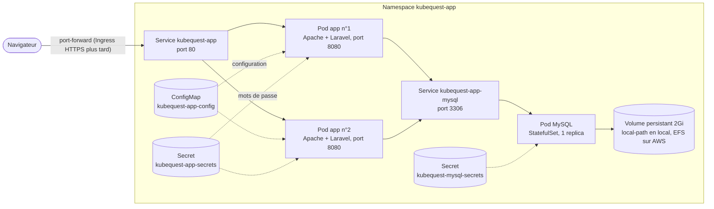
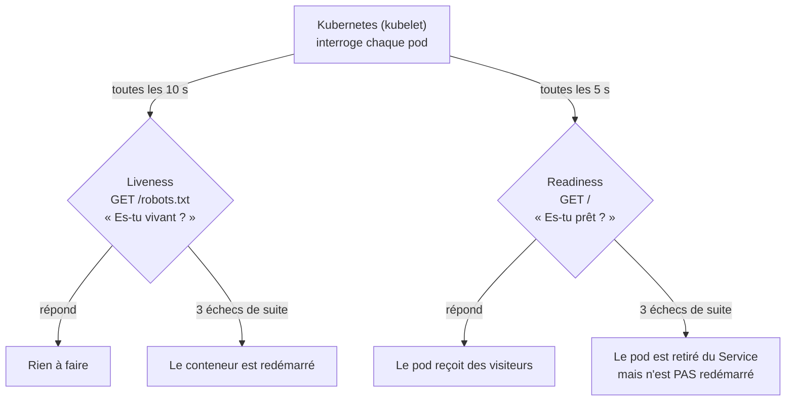
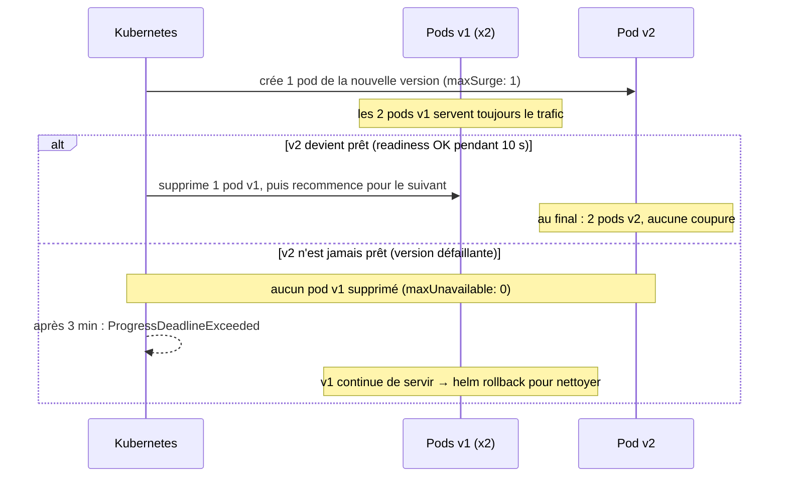

# Application — Laravel + MySQL

> Partie « application » du projet Kube : migration de l'application fournie (docker-compose) vers Kubernetes.

## Sommaire

1. [L'application](#1-lapplication)
2. [Services du docker-compose d'origine](#2-services-du-docker-compose-dorigine)
3. [Lancer l'application en local](#3-lancer-lapplication-en-local)
4. [Variables d'environnement](#4-variables-denvironnement)
5. [Corrections apportées à l'application fournie](#5-corrections-apportées-à-lapplication-fournie)
6. [Points de vigilance pour Kubernetes](#6-points-de-vigilance-pour-kubernetes)
7. [Déploiement sur Kubernetes (test local k3d)](#7-déploiement-sur-kubernetes-test-local-k3d)
   - [Vue d'ensemble](#vue-densemble)
   - [Base de données : chart officiel Bitnami](#base-de-données--chart-officiel-bitnami)
   - [Secrets (jamais dans Git)](#secrets-jamais-dans-git)
   - [Commandes](#commandes)
   - [Test de persistance](#test-de-persistance-2026-11-16)
   - [Bonnes pratiques du Deployment](#bonnes-pratiques-du-deployment)
   - [Mise à jour progressive (RollingUpdate)](#mise-à-jour-progressive-rollingupdate)
   - [Tests réalisés](#tests-réalisés-k3d)
8. [Dépannage](#8-dépannage)
   - [Les 5 commandes de diagnostic](#les-5-commandes-de-diagnostic)
   - [Problèmes fréquents](#problèmes-fréquents)
9. [À venir](#9-à-venir)

## 1. L'application

- Framework : **Laravel (PHP 7.4)**, servi par Apache
- Conteneur : utilisateur **non-root** (`www-data`), Apache sur le port **8080**
- Base de données : **MySQL 8.0**
- Fonction : un compteur. Le bouton **+1** appelle `/api/counter/add` et enregistre la valeur en base.
- Code source : `application/src/`

## 2. Services du docker-compose d'origine

| Service | Rôle | Dans Kubernetes |
|---|---|---|
| `traefik` | Porte d'entrée web | Remplacé par l'Ingress controller du cluster |
| `app` | Site Laravel, port 8080 (80 à l'origine) | Chart Helm de l'application |
| `db` | MySQL 8.0, données dans `/var/lib/mysql` | Chart Helm officiel + volume persistant (EFS) |

## 3. Lancer l'application en local

Prérequis : Docker + Docker Compose. Le port 80 doit être libre.

Depuis la racine du dépôt :

```bash
cd application/src
cp .env.example .env          # puis remplir les valeurs vides
docker compose up -d --build
docker compose exec app php artisan migrate    # crée les tables
docker compose exec app php artisan db:seed    # données de test
```

Ouvrir : http://localhost:8081

Arrêter : `docker compose down` (ajouter `-v` pour effacer la base).

Générer une `APP_KEY` :
```bash
echo "base64:$(openssl rand -base64 32)"
```

## 4. Variables d'environnement

Toutes les variables sont listées dans `application/src/.env.example`.

| Variable | Type | Rôle |
|---|---|---|
| `APP_ENV`, `APP_DEBUG` | Configuration | Mode de l'app (`APP_DEBUG=false` en déploiement) |
| `APP_KEY` | 🔒 Secret | Clé de chiffrement Laravel |
| `DB_CONNECTION`, `DB_HOST`, `DB_PORT` | Configuration | Connexion à MySQL |
| `DB_DATABASE` | Configuration | Nom de la base (partagé app + MySQL) |
| `DB_USERNAME`, `DB_PASSWORD` | 🔒 Secret | Compte applicatif (partagé app + MySQL) |
| `MYSQL_ROOT_PASSWORD` | 🔒 Secret | Compte administrateur MySQL |

**Règle :** aucun secret dans Git. Les valeurs réelles sont dans `.env`, ignoré par Git.

## 5. Corrections apportées à l'application fournie

L'archive fournie ne contenait **aucun fichier caché** (fichiers commençant par un point). Résultat : l'app ne démarrait pas, puis l'API ne répondait pas.

| Problème constaté | Cause | Correction |
|---|---|---|
| Secrets en clair dans `docker-compose.yaml` (`APP_KEY`, mots de passe) | Valeurs écrites en dur | Remplacées par `${VARIABLE}`, lues depuis `.env` |
| Pas de modèle de `.env` | `.env.example` absent | `.env.example` créé, valeurs sensibles vides |
| Risque de commiter `.env` et `vendor/` | `.gitignore` absent | `.gitignore` Laravel recréé |
| Build en échec : `bootstrap/cache directory must be present and writable` | Dossiers vides perdus | Dossiers `bootstrap/cache` et `storage/...` recréés, avec un `.gitignore` chacun |
| Bouton +1 : `GET /api/counter/add 404` | `public/.htaccess` absent : Apache n'envoyait pas les URL à Laravel | `.htaccess` Laravel standard recréé |
| Doublon README / exemple de config | Variables listées dans le README | README renvoie vers `.env.example` |
| Processus principal Apache en root | Image `php:apache` par défaut | `USER www-data` + Apache sur le port 8080 (ports < 1024 réservés à root) |
| Droits trop larges : `www-data` pouvait modifier tout le code | `chown` + `chmod -R 755` sur tous les dossiers | `chown` limité à `storage` et `bootstrap/cache` (moindre privilège) |

## 6. Points de vigilance pour Kubernetes

- **PHP 7.4 n'est plus maintenu** (fin de support fin 2022, plus de correctifs de sécurité). Non mis à jour pour ne pas casser l'app → piste d'amélioration.
- Image : 1,07 Go sur disque / 256 Mo compressée → optimisation possible (bonus image légère).
- Port du conteneur : **8080** → à utiliser dans le chart Helm (`containerPort`, Service, probes).

- `APP_KEY` de l'archive d'origine considérée comme exposée → nouvelle clé générée.
- Migration (`php artisan migrate`) : à lancer **une seule fois**, via un Job, avant le démarrage de l'app.
- L'app ne stocke rien localement → plusieurs replicas possibles.
- Le compteur sert de preuve de persistance : sa valeur doit survivre au redémarrage du pod MySQL.

## 7. Déploiement sur Kubernetes (test local k3d)

### Vue d'ensemble



- **Service** : l'adresse stable de l'app dans le cluster ; il répartit les visiteurs entre les pods **prêts**.
- **2 pods de l'app**, **sur 2 nodes différents** (anti-affinité) : si un pod ou une machine tombe, l'autre continue de servir.
- **ConfigMap / Secrets** : la configuration et les mots de passe sont **hors de l'image**.
- **MySQL** : chart officiel Bitnami ; ses données sont sur un **volume persistant** qui survit aux redémarrages.

### Base de données : chart officiel Bitnami

| Élément | Valeur | Pourquoi |
|---|---|---|
| Chart | `oci://registry-1.docker.io/bitnamicharts/mysql` **10.2.4** | Chart de référence pour MySQL, déclaré en dépendance du chart de l'app |
| MySQL | **8.0.37** | Même version majeure que le docker-compose d'origine (`mysql:8.0`) |
| Image | `bitnamilegacy/mysql:8.0.37-debian-12-r2` | Multi-arch (amd64 + arm64, nœuds AWS Graviton) |
| Authentification | `mysql_native_password` (défaut du chart) | Identique au docker-compose |
| Ressources | requests 100m / 384Mi, limits 500m / 768Mi | Nœuds t4g.medium (4 Go) : `performance_schema` désactivé pour tenir dans la limite |
| Stockage | PVC 2Gi, StorageClass par défaut | `local-path` en local ; StorageClass EFS sur AWS |

⚠️ **Limite connue** : depuis 2025, Bitnami ne publie plus gratuitement ses images à jour ; les anciennes
sont archivées dans `bitnamilegacy` et **ne reçoivent plus de correctifs**. Le chart reste disponible,
mais cette version ne sera plus mise à jour → à réévaluer (autre chart ou image maintenue).

Le Service MySQL s'appelle `<release>-mysql` : `DB_HOST` est calculé dans la ConfigMap (`{{ .Release.Name }}-mysql`).

### Secrets (jamais dans Git)

| Secret | Clés | Utilisé par |
|---|---|---|
| `kubequest-app-secrets` | `APP_KEY`, `DB_USERNAME`, `DB_PASSWORD` | l'app (`envFrom`) |
| `kubequest-mysql-secrets` | `mysql-password`, `mysql-root-password`, `mysql-replication-password` | MySQL (`auth.existingSecret`) |

`mysql-password` doit être **identique** à `DB_PASSWORD`, et `auth.username` (values.yaml) à `DB_USERNAME`.
Créés à la main en local ; SealedSecret sur le vrai cluster.

### Commandes

Depuis `application/helm/kubequest-app`, après avoir vérifié `kubectl config current-context` :

```bash
# 1. Télécharger le chart MySQL (crée Chart.lock, à commiter ; charts/ est ignoré)
helm dependency update

# 2. Secrets (namespace kubequest-app)
kubectl create namespace kubequest-app
kubectl -n kubequest-app create secret generic kubequest-app-secrets \
  --from-literal=APP_KEY="base64:$(openssl rand -base64 32)" \
  --from-literal=DB_USERNAME=app_user \
  --from-literal=DB_PASSWORD="$(openssl rand -base64 24)"
APP_PWD=$(kubectl -n kubequest-app get secret kubequest-app-secrets -o jsonpath='{.data.DB_PASSWORD}' | base64 -d)
kubectl -n kubequest-app create secret generic kubequest-mysql-secrets \
  --from-literal=mysql-password="$APP_PWD" \
  --from-literal=mysql-root-password="$(openssl rand -base64 24)" \
  --from-literal=mysql-replication-password="$(openssl rand -base64 24)"
unset APP_PWD

# 3. Installer (ou mettre à jour) l'app + MySQL
helm upgrade --install kubequest-app . -n kubequest-app

# 4. Créer les tables (une fois MySQL prêt)
kubectl -n kubequest-app exec deploy/kubequest-app -- php artisan migrate --force

# 5. Tester (le port 8080 local est pris par le load balancer k3d)
kubectl -n kubequest-app port-forward svc/kubequest-app 8090:80
curl -s localhost:8090/api/counter/add
curl -s localhost:8090/api/counter/count
```

### Test de persistance (2026-11-16)

Compteur à **6** → `kubectl -n kubequest-app delete pod kubequest-app-mysql-0` → pod recréé →
compteur toujours à **6** ✅ (même PVC `data-kubequest-app-mysql-0`).

### Bonnes pratiques du Deployment

| Réglage | Valeur | Pourquoi |
|---|---|---|
| Replicas | **2** | Si un pod tombe, l'autre continue de servir |
| Anti-affinité | `required`, `topologyKey: kubernetes.io/hostname` | Jamais 2 pods de l'app sur la même machine : l'app survit à la perte d'un **node**, pas seulement d'un pod |
| Ressources | requests 100m / 128Mi, limits 500m / 256Mi | Réserver le nécessaire, ne jamais prendre la place des autres (nœuds de 4 Go partagés) |
| Liveness probe | `GET /robots.txt` | « Le pod est-il vivant ? » : fichier statique servi par Apache, **sans** Laravel ni MySQL |
| Readiness probe | `GET /` | « Le pod peut-il servir ? » : la page lit le compteur en base |
| Utilisateur | non-root, `runAsUser: 33` (www-data) | Moindre privilège. Valeur **numérique** obligatoire : l'image déclare `USER www-data` (un nom), que Kubernetes ne sait pas vérifier |
| Droits | `allowPrivilegeEscalation: false`, `capabilities: drop ALL`, seccomp `RuntimeDefault` | L'app ne peut pas gagner de droits supplémentaires |
| Token Kubernetes | non monté (`automount: false`) | L'app n'appelle jamais l'API Kubernetes |
| Labels | `app.kubernetes.io/*` + `part-of: kubequest` | Recommandations Kubernetes + policy 04 |
| Annotation `checksum/config` | empreinte de la ConfigMap | Les pods redémarrent automatiquement quand la configuration change |

**Pourquoi la liveness n'est pas sur `/`** : si MySQL tombe, `/` répond 500. Avec une liveness sur `/`,
Kubernetes redémarrerait tous les pods de l'app en boucle (`CrashLoopBackOff`), sans rien réparer.
Avec la séparation liveness / readiness, les pods restent vivants et sont seulement retirés du trafic.
C'est aussi ce qui empêchera une version défaillante de recevoir du trafic (démo du déploiement progressif).



Exemple vécu lors du test de coupure de MySQL : `/robots.txt` répond toujours (liveness ✅, pas de
redémarrage), `/` répond 500 (readiness ❌, plus de trafic) → dès que MySQL revient, `/` répond à
nouveau et les pods reçoivent de nouveau des visiteurs, **sans aucun redémarrage**.

### Mise à jour progressive (RollingUpdate)

Quand une nouvelle version est déployée, Kubernetes remplace les pods **un par un**, sans jamais
réduire le nombre de pods prêts.

| Réglage | Valeur | Pourquoi |
|---|---|---|
| `strategy.type` | `RollingUpdate` | Remplacement progressif, pod par pod |
| `maxSurge` | `1` | Un pod de la nouvelle version est créé **en plus** (3 pods pendant la mise à jour ; 3 nodes → compatible avec l'anti-affinité) |
| `maxUnavailable` | `0` | Un ancien pod n'est supprimé **qu'une fois le nouveau prêt** : jamais moins de 2 pods qui servent |
| `minReadySeconds` | `10` | Le nouveau pod doit rester prêt 10 s avant d'être jugé fiable |
| `progressDeadlineSeconds` | `180` | Si la nouvelle version n'est pas prête en 3 min, la mise à jour est déclarée en échec (`ProgressDeadlineExceeded`) ; les anciens pods continuent de servir |



**C'est ce qui empêche une version défaillante de prendre la place** : sa readiness échoue, elle ne
reçoit jamais de trafic, et l'ancienne version reste en service jusqu'au retour en arrière.

### Tests réalisés (k3d)

| Test | Commande | Résultat |
|---|---|---|
| Admission policies appliquées en local (01, 02, 04, 05) | `kubectl apply -f 01-non-root.yaml -f 02-resources.yaml -f 04-labels.yaml -f 05-readiness-probe.yaml` | Chart accepté ✅ |
| Coupure de MySQL | `kubectl -n kubequest-app scale statefulset kubequest-app-mysql --replicas=0` puis `=1` | Pods de l'app en `0/1` puis `1/1`, **0 restart** ✅ |
| Test Helm | `helm test kubequest-app -n kubequest-app` | `Phase: Succeeded` ✅ |
| Pod non conforme | `kubectl -n kubequest-app run pirate --image=nginx:1.27` | **Refusé** par `kubequest-non-root` ✅ |
| Anti-affinité (3 nodes) | `kubectl -n kubequest-app scale deployment kubequest-app --replicas=4` | 3 pods `Running` (1 par node) + 1 pod `Pending` : `3 node(s) didn't match pod anti-affinity rules` ✅ |
| Mise à jour sans coupure | `kubectl -n kubequest-app rollout restart deployment kubequest-app`, avec un pod de test qui appelle le Service toutes les 0,5 s | Pods remplacés un par un ; **aucune requête en erreur** ✅ |
| Version défaillante | `helm upgrade kubequest-app . -n kubequest-app --set readinessProbe.httpGet.path=/page-qui-nexiste-pas` | Nouveau pod bloqué en `0/1`, les 2 anciens restent `1/1` ; après 3 min : `ProgressDeadlineExceeded` ✅ |
| Trafic pendant les 2 tests ci-dessus | Pod de test, ~10 min | **895 requêtes, 895 réponses `200`**, zéro erreur ✅ |
| Retour en arrière | `helm rollback kubequest-app 6 -n kubequest-app` | Pod défaillant supprimé, nouvelle révision 8 « Rollback to 6 » ✅ |

La policy 03 (images GHCR uniquement) n'est pas encore appliquée en local : les images de l'app
et de MySQL seront poussées dans le registry au passage sur AWS.

## 8. Dépannage

### Les 5 commandes de diagnostic

À lancer dans cet ordre quand quelque chose ne va pas (après avoir vérifié `kubectl config current-context`) :

```bash
kubectl -n kubequest-app get pods                         # 1. état des pods (READY, STATUS, RESTARTS)
kubectl -n kubequest-app describe pod <nom-du-pod>        # 2. section "Events" en bas : pourquoi il ne démarre pas
kubectl -n kubequest-app logs <nom-du-pod>                # 3. ce que l'app affiche (erreurs Laravel / MySQL)
kubectl -n kubequest-app logs <nom-du-pod> --previous     # 4. logs du conteneur AVANT son dernier redémarrage
kubectl -n kubequest-app get events --sort-by=.lastTimestamp   # 5. tout ce qui s'est passé récemment dans le namespace
```

Lire un `STATUS` :

| STATUS | Signification |
|---|---|
| `Running` + `1/1` | Tout va bien |
| `Running` + `0/1` | Le conteneur tourne mais n'est **pas prêt** (readiness en échec) : il ne reçoit pas de trafic |
| `CrashLoopBackOff` | Le conteneur plante ou est tué en boucle ; Kubernetes attend de plus en plus longtemps avant de réessayer (jusqu'à 5 min) |
| `ImagePullBackOff` / `ErrImagePull` | L'image ne peut pas être téléchargée (nom, tag ou accès au registry) |
| `Pending` | Aucun node ne peut accueillir le pod (ressources insuffisantes, volume non disponible…) |

### Problèmes fréquents

✅ = rencontré pendant nos tests.

| Symptôme | Cause | Solution |
|---|---|---|
| ✅ Logs : `getaddrinfo for mysql failed` | L'app ne trouve pas MySQL : base absente ou `DB_HOST` incorrect | Vérifier que le pod `kubequest-app-mysql-0` existe et que `DB_HOST` vaut `<release>-mysql` |
| ✅ Logs : `SQLSTATE[42S02] Table 'app_database.counters' doesn't exist` | Les migrations n'ont pas été lancées | `kubectl -n kubequest-app exec deploy/kubequest-app -- php artisan migrate --force` |
| Logs : `SQLSTATE[HY000] [1045] Access denied for user` | Le mot de passe de l'app (`DB_PASSWORD`) est différent de celui de MySQL (`mysql-password`) | Remettre la même valeur dans les deux Secrets. ⚠️ MySQL n'enregistre le mot de passe **qu'à la première création du volume** : changer le Secret ensuite ne change pas le mot de passe en base |
| ✅ `kubectl exec` échoue : `container not found` | Le pod est en `CrashLoopBackOff`, aucun conteneur ne tourne au moment de la commande | `kubectl -n kubequest-app rollout restart deployment kubequest-app`, puis relancer la commande dès que le pod est `Running` |
| ✅ `port-forward` : `bind: address already in use` | Le port local est déjà pris (en local, `8080` est utilisé par le load balancer k3d) | Utiliser un autre port : `port-forward svc/kubequest-app 8090:80` |
| ✅ Pods de l'app en `0/1` après un redémarrage de MySQL | MySQL met 30 à 60 s à redémarrer ; tant qu'il n'est pas prêt, `/` répond 500 | Attendre : les pods redeviennent `1/1` seuls, sans redémarrage. Vérifier que `kubequest-app-mysql-0` est bien `1/1` |
| ✅ Refus : `ValidatingAdmissionPolicy 'kubequest-…' denied request` | La ressource ne respecte pas une règle du cluster ; le nom de la policy et le message indiquent laquelle | `non-root` → `runAsNonRoot` / `allowPrivilegeEscalation: false` · `resources` → requests + limits CPU et mémoire · `labels` → `app.kubernetes.io/name`, `instance`, `part-of: kubequest` · `readiness-probe` → readinessProbe · `allowed-images` → image du registry privé avec un tag explicite |
| Pod bloqué : `image has non-numeric user (www-data), cannot verify user is non-root` | `runAsNonRoot: true` avec une image qui déclare un **nom** d'utilisateur | Indiquer l'uid numérique : `runAsUser: 33` (déjà fait dans `values.yaml`) |
| ✅ Pod de l'app en `Pending` : `didn't match pod anti-affinity rules` | Chaque node a déjà un pod de l'app (anti-affinité) : il y a plus de replicas que de nodes | Normal si `replicas` > nombre de nodes. Réduire les replicas ou ajouter un node |
| ✅ MySQL en `Pending` au redémarrage du cluster : `didn't match PersistentVolume's node affinity` | En local, le volume `local-path` est sur le disque d'**une seule** machine : MySQL ne peut démarrer que là, et attend qu'elle soit prête | Attendre que le node soit `Ready`. Sur AWS, le volume EFS est **partagé** entre les machines : le problème disparaît |
| ✅ `rollout status` : `exceeded its progress deadline` / un nouveau pod reste en `0/1` | La nouvelle version n'est jamais prête (readiness en échec) : la mise à jour est bloquée, l'ancienne version sert toujours | `describe pod` du nouveau pod (section Events) pour voir pourquoi ; corriger, ou revenir en arrière : `helm history` puis `helm rollback kubequest-app <révision> -n kubequest-app` |
| ✅ `kubectl logs -f` : `failed to create fsnotify watcher: too many open files` | Limite Linux `inotify` atteinte sur le poste (WSL / k3d) ; le pod, lui, fonctionne | Sans suivi en direct : `kubectl logs <pod> --tail=20`. Durable : `sudo sysctl fs.inotify.max_user_instances=512` (et l'ajouter dans `/etc/sysctl.d/`) |
| ✅ La ConfigMap a changé mais l'app garde les anciennes valeurs | Les variables d'environnement ne sont lues qu'au démarrage du pod | Automatique grâce à l'annotation `checksum/config` ; sinon `kubectl -n kubequest-app rollout restart deployment kubequest-app` |
| ✅ `helm lint` : `chart directory is missing these dependencies: mysql` | Le chart MySQL n'a pas été téléchargé (`charts/` n'est pas dans Git) | `helm dependency update` dans `application/helm/kubequest-app` |
| `ImagePullBackOff` sur l'app | Image introuvable dans le cluster (local) ou Secret `regcred` absent (registry privé) | En local : importer l'image dans k3d (`k3d image import kubequest-app:<tag> -c <cluster>`). Sur AWS : vérifier `imagePullSecrets` et le Secret `regcred` |
| ✅ `kubectl` : `connection refused` | Le cluster local est arrêté, ou le mauvais contexte est sélectionné | `kubectl config current-context`, puis `k3d cluster start <cluster>` |

## 9. À venir

- [x] Cluster local de test (k3d)
- [ ] Image dans le registry privé
- [x] Chart Helm de l'application
- [x] Base MySQL via chart officiel
- [x] Deployment : replicas, probes, resources, labels, non-root
- [x] Anti-affinité : replicas sur des nodes différents
- [x] Stratégie RollingUpdate (mise à jour sans coupure, version défaillante bloquée)
- [ ] Migrations via un Job (au lieu de `kubectl exec`)
- [ ] Déploiement GitOps (ArgoCD)
